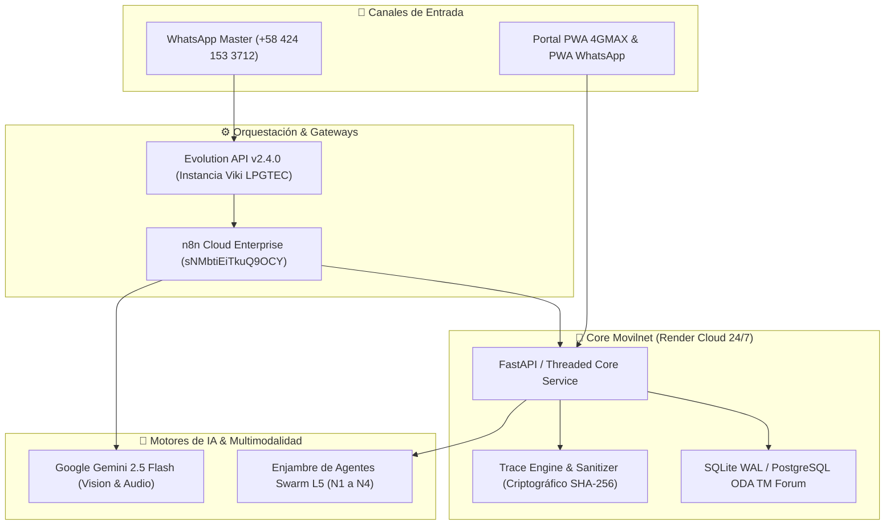

# 🧭 GUÍA DE REVISIÓN PARA ASOCIADOS Y AUDITORÍA EXTERNA
## Proyecto: Telecomunicaciones Movilnet C.A. — Core PWA Swarm L5 & Asistente MOVI 4GMAX
**Fecha de Publicación:** 26 de Octubre de 2026  
**Rama de Revisión Pública:** `revision-asociado`  
**Repositorio Oficial en GitHub:** [`https://github.com/Idoysara/121026_IDS_MOVILNET_PWA`](https://github.com/Idoysara/121026_IDS_MOVILNET_PWA)  
**Ruta Directa de la Rama:** [`https://github.com/Idoysara/121026_IDS_MOVILNET_PWA/tree/revision-asociado`](https://github.com/Idoysara/121026_IDS_MOVILNET_PWA/tree/revision-asociado)  
**Gobernanza:** Universal Best Practices Engineering Rule (Pilares I al VII) & Zero-PII  

---

## 🎯 1. Propósito de Esta Ruta de Revisión
Este espacio público ha sido acondicionado para que asociados, auditores técnicos y desarrolladores aliados puedan inspeccionar, verificar y validar de forma transparente e integral la arquitectura, código fuente, flujos de orquestación, contratos de API y telemetría en tiempo real del ecosistema de autogestión de **Movilnet**.

---

## 🌐 2. Accesos en Vivo y Despliegues 24/7 (Cero Instalación)
El proyecto cuenta con despliegues activos en la nube que pueden auditarse directamente desde cualquier navegador web o dispositivo móvil:

| Servicio / Interfaz | URL Pública en Vivo | Propósito |
| :--- | :--- | :--- |
| **Portal PWA 4GMAX Oficial** | [👉 Abrir Portal PWA](https://one21026-ids-movilnet-pwa-bxmz.onrender.com/ui/pwa_stitch/index.html) | Aplicación web progresiva para consulta de saldo, recargas C2P y autogestión. |
| **Tablero Conversatorio E2E ($N \longleftrightarrow 1$)** | [👉 Abrir Monitor Conversatorio](https://one21026-ids-movilnet-pwa-bxmz.onrender.com/ui/monitor/conversatorio.html) | Monitor de supervisión en tiempo real de interacciones entre los $N$ abonados y MOVI. |
| **PWA WhatsApp Nativa (Standalone)** | [👉 Abrir PWA WhatsApp](https://movilnet-pwa-whatsapp.onrender.com/) | Interfaz desacoplada idéntica a WhatsApp Web con modales interactivos Flow. |
| **Radar Cazador de Ofertas** | [👉 Consultar Ofertas JSON](https://one21026-ids-movilnet-pwa-bxmz.onrender.com/api/v1/cazador/ofertas) | Microservicio geoespacial con 56 comercios aliados y 204 ofertas activas. |
| **Línea WhatsApp Master Oficial** | `+58 424 153 3712` | Número celular oficial enlazado a Evolution API v2.4.0 (`Viki LPGTEC`) y n8n Cloud. |

---

## 🏗️ 3. Arquitectura del Sistema y Módulos Clave
El proyecto opera bajo una **Arquitectura Limpia / Hexagonal Desacoplada**:



### Componentes de Interés para Auditoría:
1. **[`core/trace_sanitizer_certifier.py`](file:///Users/ismael/Desktop/121026_CORE_MOVILNET/Movilnet_141026/141026_Movilnet_Core_PWA/core/trace_sanitizer_certifier.py):**
   - Sanitizador perimetral, generador de hashes SHA-256 inmutables y preservación incondicional de respuestas multimodales reales provenientes de Gemini Vision.
2. **[`core/conversation_trace_engine.py`](file:///Users/ismael/Desktop/121026_CORE_MOVILNET/Movilnet_141026/141026_Movilnet_Core_PWA/core/conversation_trace_engine.py):**
   - Fachada hexagonal para reconstrucción del pipeline temporal ($T_1 \dots T_8$) y monitoreo en vivo de latencias en milisegundos.
3. **[`api/service.py`](file:///Users/ismael/Desktop/121026_CORE_MOVILNET/Movilnet_141026/141026_Movilnet_Core_PWA/api/service.py):**
   - Endpoints REST Carrier-Grade con inyección automática de la regla inviolable del sufijo PWA universal.
4. **[`services/cazador_ofertas/`](file:///Users/ismael/Desktop/121026_CORE_MOVILNET/Movilnet_141026/141026_Movilnet_Core_PWA/services/cazador_ofertas/):**
   - Módulo desacoplado de ofertas por proximidad geográfica, cuponería TOTP con expiración de 60s y split de ingresos 20/80.
5. **[`docs/BITACORA_MOVILNET.md`](file:///Users/ismael/Desktop/121026_CORE_MOVILNET/Movilnet_141026/141026_Movilnet_Core_PWA/docs/BITACORA_MOVILNET.md):**
   - Historial cronológico con **245 Capítulos técnicos** detallando cada decisión de ingeniería, pruebas, incidentes y resoluciones con evidencia dura.

---

## 🧪 4. Verificación y Batería de Pruebas
El proyecto sigue el **Pilar V (Regla del 100% Pass)**:

```bash
# 1. Clonar el repositorio
git clone -b revision-asociado https://github.com/Idoysara/121026_IDS_MOVILNET_PWA.git
cd 121026_IDS_MOVILNET_PWA

# 2. Crear entorno virtual e instalar dependencias
python3 -m venv venv
source venv/bin/activate
pip install -r requirements.txt

# 3. Ejecutar pruebas unitarias de componentes Core
python3 core/trace_sanitizer_certifier.py --test

# 4. Ejecutar suite de pruebas de la PWA
python3 tests/test_pwa_whatsapp_suite.py
```

---

## 🔒 5. Políticas de Seguridad y Privacidad (Zero-PII)
- **Cero Datos Sensibles:** Números de teléfono se ofuscan o indexan mediante HMAC Blind Index (`CONATEL`).
- **Cero Almacenamiento de Multimedia Cruda:** Las imágenes y audios se procesan en memoria volátil de tensor y son descartadas inmediatamente tras la inferencia de Gemini.
- **Trazabilidad Criptográfica:** Cada transacción cuenta con un sello hash SHA-256 verificado.

---

```text
🌐 Portal PWA 4GMAX (Acceso libre por Wi-Fi o Datos Móviles — Cualquier Operadora):
👉 https://one21026-ids-movilnet-pwa-bxmz.onrender.com/ui/pwa_stitch/index.html
```
