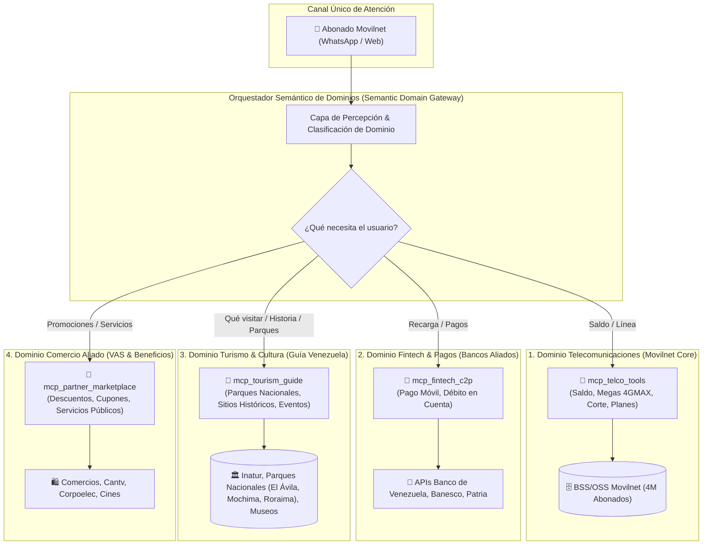

# 🌐 Arquitectura de Ecosistema Multi-Servicio y Super-App Telco (B2B2C)
## Proyecto: `AI_Movilnet_300926` — Telecomunicaciones Movilnet C.A.
**Fundamento Estratégico:** *"La cuenta y línea Movilnet como Llave de Identidad y Pasarela de Servicios Propios y de Terceros (Banca, Turismo, Sitios Históricos, Servicios Públicos y Comercio)."*  
**Estándar:** TM Forum Open Digital Architecture (ODA) & Smart MCP Routing  
**Fecha:** 2026-09-30  
**Versión:** 1.0.0 Maestro  

---

## 1. ¿Por qué esto se DEBE considerar desde la FASE 0?

Si un proyecto de telecomunicaciones no concibe la extensibilidad multi-servicio desde su concepción (**Fase 0**), incurre en tres **fallas críticas de diseño (Deuda Técnica Fatal)**:

1. **Aislamiento de Datos y Privacidad Multi-Inquilino (Multi-Tenancy Zero-Trust):**  
   Una empresa aliada (un banco, una aerolínea o el Ministerio de Turismo) **jamás debe tener acceso a las tablas de facturación o contratos de Movilnet**. El modelo de datos debe diseñarse desde el inicio con particiones estrictas y muros de privacidad (*Privacy Walls*).
2. **Saturación de Contexto de la IA (Context Pollution):**  
   Si inyectas herramientas de saldo, pagos, turismo, parques y comercio en un solo prompt, el modelo de IA alucina, pierde precisión y el costo de tokens se dispara. Se requiere un **Enrutador Semántico de Dominios (Semantic Domain Router)** que active únicamente las herramientas del tema que el abonado está consultando.
3. **Escalabilidad de Alianzas Comerciales (Plugin-Play B2B):**  
   Nuevas empresas deben poder integrarse mediante contratos OpenAPI y servidores MCP estandarizados sin que tengamos que reescribir ni una sola línea del núcleo de Movilnet.

---

## 2. Benchmark Mundial: Casos de Éxito de Telco Super-Apps con IA

A nivel global, las operadoras líderes han dejado de ser simples "tuberías de datos" para convertirse en el **centro de vida digital de sus países**:

| Operadora / Aplicación | País / Usuarios | Modelo de Integración Multi-Servicio | Servicios de Terceros que Ofrece |
|:---|:---|:---|:---|
| **Reliance Jio (`MyJio / JioAI`)** | 🇮🇳 India<br/>*(450M abonados)* | **Super-App Conversacional:** La línea móvil es la identidad universal para servicios propios y aliados. | • `JioMart` (Compras en tiendas de barrio)<br/>• `JioUPI` (Pagos interbancarios)<br/>• Guía de turismo, templos y reservas de trenes<br/>• Salud digital y streaming |
| **Safaricom (`M-Pesa / Zuri AI`)** | 🇰🇪 Kenia / África<br/>*(32M abonados)* | **Chatbot Transaccional en WhatsApp y App:** Gestiona más del 50% del PIB del país en transacciones. | • Pago de servicios públicos (Agua, Electricidad)<br/>• Compra de entradas a Parques Nacionales (Safari)<br/>• Microcréditos bancarios y remesas<br/>• Pagos a pequeños comerciantes |
| **Telefónica / Movistar (`Aura`)** | 🇪🇸 España / LatAm<br/>*(100M+ abonados)* | **Ecosistema de "Living Apps":** La IA conecta el hogar y el móvil con marcas aliadas. | • Alianzas con Iberia (vuelos y turismo)<br/>• Banco Santander (finanzas)<br/>• El Corte Inglés (comercio electrónico)<br/>• Eventos culturales y carteleras locales |
| **Globe Telecom (`GCash / Gie AI`)** | 🇵🇭 Filipinas<br/>*(80M abonados)* | **Marketplace de Estilo de Vida:** De saldo celular a billetera de turismo y consumo nacional. | • Guía turística de islas y monumentos históricos<br/>• Delivery de comida con comercios aliados<br/>• Seguros de viaje y pagos QR en transporte |
| **Tencent (`WeChat Mini-Programs`)** | 🇨🇳 China<br/>*(1.3B usuarios)* | **Referente Universal de Super-App:** Identidad del número celular para interactuar con todo el país. | • Entradas a museos y sitios patrimoniales<br/>• Servicios gubernamentales y trámites<br/>• Comercio y transporte sin salir del chat |

---

## 3. Algoritmos y Patrones Clave en GitHub para este Enfoque

| Algoritmo / Repositorio | Tipo / Enfoque | Cómo se Aplica en Movilnet AI |
|:---|:---|:---|
| **`Semantic Router / MCPlex`**<br/>*(spak2005/smart-mcp, ModernOps888/mcplex)* | Enrutador Semántico de Herramientas MCP | Clasifica la intención del usuario en milisegundos mediante embeddings locales y conecta **exclusivamente el MCP del dominio pertinente** (Telco, Banca o Turismo). |
| **`TM Forum Open Digital Architecture (ODA)`**<br/>*(tmforum-rand/Open_API_And_Data_Model)* | Estándares Abiertos de Telecomunicaciones | Implementa los contratos universales:<br/>• **TMF620:** Catálogo de Productos y Servicios aliados.<br/>• **TMF680:** Motor de Recomendación contextual.<br/>• **TMF678:** Facturación unificada de servicios de valor agregado. |
| **`LangGraph Multi-Agent Supervisor`** | Orquestación Jerárquica de Agentes | Un agente supervisor determina si la consulta es de Movilnet o de un partner, delegando al subagente especialista sin mezclar contextos. |
| **`Outlines / Typesafe AI`** | Validación Estricta de Esquemas JSON | Asegura que las respuestas de empresas aliadas cumplan con el contrato de datos antes de ser mostradas al usuario en WhatsApp. |

---

## 4. Diagrama del Ecosistema B2B2C Movilnet AI Marketplace



---

## 5. Ejemplo Real de Interacción Multidominio en el Mismo Chat

```text
Usuario: "Hola, ¿cuántos megas me quedan?"
🤖 Asistente: "Le quedan 4.2 GB de su plan Inteliplan 10GB."

Usuario: "¿Y qué sitios turísticos me recomiendas visitar este fin de semana en Caracas?"
🤖 Asistente: (El Router activa el dominio de Turismo sin perder la sesión)
"En Caracas le recomiendo:
 🌿 Parque Nacional Warairarepano (El Ávila): Ideal para senderismo o teleférico.
 🏛️ Casco Histórico y Casa Natal del Libertador: Museos abiertos con entrada libre.
 🎭 Complejo Cultural Teresa Carreño: Cartelera cultural y exposiciones activas.
 ¿Desea conocer las rutas de transporte o eventos programados?"

Usuario: "Excelente, y por cierto, ¿hay alguna promoción con aliados Movilnet para entradas de cine?"
🤖 Asistente: (El Router activa el dominio VAS/Comercios)
"¡Sí! Como abonado 4GMAX Movilnet, tiene 2x1 en entradas los días jueves en Cines Unidos presentando el código #MOV-CINE..."
```
