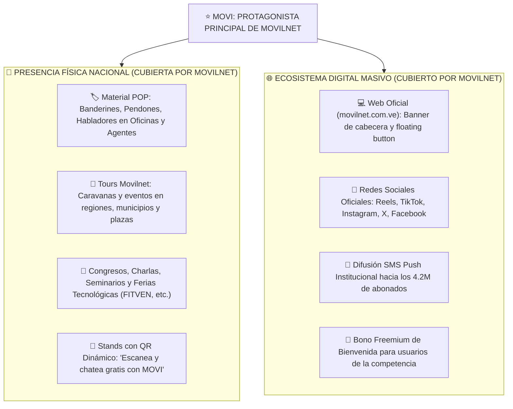
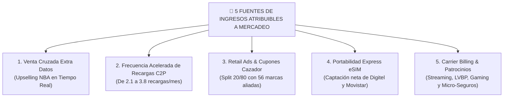
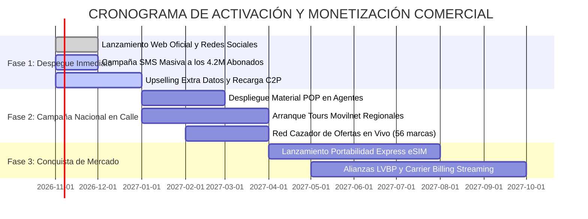

# 🎯 GUÍA Y PRESENTACIÓN ESTRATÉGICA PARA EL DEPARTAMENTO DE MERCADEO
## Proyecto: Ecosistema Omnicanal MOVI 4GMAX — Telecomunicaciones Movilnet C.A.
**Dirigido a:** Vicepresidencia de Mercadeo, Gerencia de Marca, Producto, Eventos y Medios Digitales  
**Enfoque:** MOVI como Protagonista Principal, Activación Masiva POP, Tours Movilnet, Ecosistema Digital y Generación de Nuevos Ingresos  
**Fecha:** Octubre 2026 | **Versión:** 2.0 — Estrategia de Marca, Canales Nacionales & Monetización  

---

## 💡 El Rol Soberano del Departamento de Mercadeo en la Alianza

> **"Movilnet NO requiere aportar fondos económicos en efectivo para este proyecto. El capital tecnológico y la IA están 100% financiados por el inversionista.  
> El aporte estratégico y soberano de Movilnet es su mayor poder: su base de ~4.2 Millones de usuarios, la fuerza de su marca nacional, su despliegue de material POP, los Tours Movilnet en cada región, sus redes sociales y su página web oficial, posicionando al Asistente MOVI como el PROTAGONISTA PRINCIPAL de la empresa."**

---

## 🌟 1. MOVI: El Protagonista Principal de la Marca Movilnet

MOVI no es un "chatbot escondido" en un menú secundario; es la **cara visible del renacimiento tecnológico de Movilnet**:



---

## 🎪 2. El Plan de Activación Física en Calle: Tours Movilnet & Material POP

El Departamento de Mercadeo lidera la presencia en el terreno a través de los canales institucionales existentes:

### 2.1. Material POP Oficial en Puntos de Venta y Agentes Autorizados
* **Banderines y Pendones de Alto Impacto:** Identificando cada tienda física de Movilnet y agente comercial con la imagen oficial de MOVI: *"Recarga en 12 segundos por WhatsApp con MOVI — Sin colas ni esperas"*.
* **Habladores en Taquilla:** Guían al cliente en cola a escanear el código QR para autogestionar su saldo o reclamo en su celular de inmediato.
* **Tótems y Material Expositivo:** Desplegados en centros comerciales y oficinas de atención con tabletas de demostración de la PWA 4GMAX.

### 2.2. Tours Movilnet a Nivel Nacional, Regional y Municipal
* **Caravanas y Jornadas de Conectividad:** En cada parada de los **Tours Movilnet**, MOVI es el centro de atención interactiva.
* **Demostraciones en Vivo:**
  - Los promotores retan al público a consultar su saldo en vivo o recargar por Pago Móvil C2P en menos de 15 segundos.
  - Sorteos y trivias gamificadas conducidas por la IA en WhatsApp.
* **Cobertura de Gastos:** Toda la logística, montaje de tarimas, sonido, stands y personal de campo forman parte del despliegue natural y presupuesto ordinario de Mercadeo de Movilnet (cero costo para el inversor tecnológico).

### 2.3. Charlas, Seminarios, Conferencias y Exposiciones
* Participación de Movilnet en ferias de telecomunicaciones, turismo, comercio y universidades con stands dedicados a la **"Inteligencia Artificial al Servicio del Pueblo"**.
* Charlas de vocería corporativa mostrando a MOVI como caso de éxito de soberanía tecnológica nacional.

---

## 🌐 3. Despliegue en Medios Digitales y Redes Sociales

### 3.1. Página Web Oficial (`movilnet.com.ve`)
* **Hero Banner Principal:** Todo visitante a la web encuentra de entrada a MOVI con llamada a la acción: *"¿Necesitas ayuda o saldo? Escribe ya a nuestro WhatsApp oficial `+58 424 153 3712` o entra a la PWA sin gastar tus datos"*.
* **Floating Widget:** Acceso directo en 1 clic al portal PWA desde cualquier subpágina.

### 3.2. Estrategia de Contenidos en Redes Sociales (Social Media Viral)
* **Instagram & TikTok:** Videos cortos y reels mostrando casos cotidianos:
  - *"Me quedé sin megas a medianoche: mira cómo MOVI me recargó en 12 segundos sin entrar al banco"*.
  - *"Escaneé el recibo arrugado del Pago Móvil y MOVI me acreditó el saldo al instante con su visión artificial"*.
* **Campaña de Conquista de Líneas Rivales (0414/0424 y 0412):**
  - Campaña masiva: *"¿Tienes otra operadora? Chatea con MOVI y recibe 1.000 tokens de IA gratis. Si te portas a Movilnet con eSIM, te regalamos 10 GB de navegación"*.

---

## 💰 4. ¿Cómo y por Dónde Entran los Ingresos Económicos Atribuibles a Mercadeo?

Para el equipo de Mercadeo, los ingresos son medibles con atribución directa mediante 5 canales:



| Fuente de Ingresos | Mecanismo Comercial | Impacto Año 1 | Impacto Año 3 |
| :--- | :--- | :---: | :---: |
| **1. Extra Datos Contextual** | Oferta personalizada cuando restan <200 MB. Tasa de aceptación del 8.7%. | **$840.000 USD** | **$3.360.000 USD** |
| **2. Recargas Aceleradas C2P** | Aumento de frecuencia de recargas de 2.1 a 3.8 veces/mes por facilidad de 12s. | **$252.000 USD** | **$1.344.000 USD** |
| **3. Red Cazador de Ofertas** | Cupones retail (Arturo's, Farmahorro, Cines) con comisión split 20/80. | **$420.000 USD** | **$2.688.000 USD** |
| **4. Portabilidad Express eSIM** | Captura de 120k abonados de la competencia con LTV de $42/año a CAC = $0. | **$5.040.000 USD** | **$12.600.000 USD** |
| **5. Patrocinios & Eventos (LVBP)** | Bolsas temáticas deportivas y eventos culturales durante los Tours Movilnet. | **$320.000 USD** | **$1.200.000 USD** |

---

## ⏳ 5. Cronograma de Ingresos (Time-to-Money para Mercadeo)



* **Día 1 a 30 (Quick Wins):** Ingresos inmediatos por aceleración de recargas C2P y venta de Extra Datos impulsados por la campaña en redes y web oficial.
* **Mes 2 a 4:** Escalamiento masivo con los **Tours Movilnet** en plazas y regiones, capturando ingresos por cuponería comercial y captación de clientes de la competencia.
* **Mes 5 en adelante:** Portabilidad masiva eSIM, consolidando a Movilnet como la operadora líder en crecimiento neto de clientes.

---

```text
🌐 Portal PWA 4GMAX (Acceso libre por Wi-Fi o Datos Móviles — Cualquier Operadora):
👉 https://one21026-ids-movilnet-pwa-bxmz.onrender.com/ui/pwa_stitch/index.html
```
