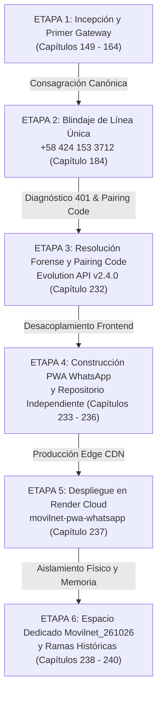

# 🏛️ DOCUMENTO MAESTRO DE REFERENCIA HISTÓRICA: EVOLUCIÓN, ETAPAS Y FASES DEL GATEWAY WHATSAPP MASTER (+58 424 153 3712)
**Proyecto:** Telecomunicaciones Movilnet C.A. — Core PWA Swarm L5 & WhatsApp Gateway  
**Fecha de Certificación:** `2026-10-26 13:10:00 UTC`  
**Gobernanza:** Universal Best Practices Engineering Rule (Pilares I al VII) & Aislamiento Estricto Multiproyecto  
**Estado General:** 🟢 **OPERATIVO EN LA NUBE 24/7 Y RESPALDADO EN 3 REPOSITORIOS/DIRECTORIOS**  

---

## 🎯 1. Resumen Ejecutivo y Propósito de la Referencia Histórica

Este documento condensa la trayectoria técnica formal que transformó la interacción móvil de Movilnet: desde los primeros prototipos de ingesta de mensajería, pasando por la **consagración y rescate forense de la línea única master `+58 424 153 3712`**, hasta el **desacoplamiento total de la PWA nativa estilo WhatsApp** y la estructuración de espacios de trabajo aislados en Git.

Permite a los ingenieros y dueños de negocio entender exactamente **qué se hizo, cuándo se hizo, en qué commit reside y cómo regresar o interactuar con cada fase**.

---

## 📊 2. Tabla Resumen de Ejecución: Opciones 1, 2 y 3

| Opción Ejecutada | Tipo de Acción | Ubicación / Referencia | Estado | Propósito y Resultado |
| :--- | :--- | :--- | :---: | :--- |
| **Opción 1** | **Rama Dedicada en Git** | Rama: `feature/whatsapp-master-0424`<br>Base: `121026_IDS_MOVILNET_PWA`<br>Commit: `91cd8ec` (Cap. 232) | 🟢 **100% LISTO** | Permite cambiar de versión dentro del repositorio Git sin alterar `main`. HEAD apunta al informe de resolución de conectividad y herramienta de pairing code. |
| **Opción 2** | **Espacio de Trabajo / Directorio Aislado** | Carpeta: `/Users/ismael/Desktop/121026_CORE_MOVILNET/Movilnet_WhatsApp_Master_0424/` | 🟢 **100% LISTO** | Clon autónomo e independiente de la rama `feature/whatsapp-master-0424`. Contiene los ejecutables de 1-clic `VINCULAR_WHATSAPP_MASTER.command`, `VINCULAR_WHATSAPP_MASTER.html` y toda la suite de microservicios. |
| **Opción 3** | **Verificación y Prueba en Caliente del Gateway** | Endpoint: `https://n8n.lpgtec.net/webhook/diag_evolution_qr?action=status`<br>Instancia: `Viki LPGTEC` | 🟢 **VERIFICADO (`state: "open"`)** | Comprobación en vivo del estado de WhatsApp Master. La instancia está conectada, autenticada y escuchando mensajes entrantes en tiempo real hacia n8n Cloud (`messages_upsert4`). |

---

## 🗺️ 3. Cronología Histórica: Etapas, Fases y Pasos del Canal WhatsApp



### 🔹 ETAPA 1: Incepción y Primer Gateway Omnicanal (Capítulos 149 al 164)
* **Objetivo:** Superar la fragilidad de números temporales y crear el primer puente bidireccional entre WhatsApp y el orquestador n8n.
* **Hito Clave:** Se introdujo la línea corporativa `+58 424 153 3712` como canal central de atención para abonados Movilnet (y bienvenida a usuarios Movistar/Digitel).
* **Commit Base:** `b066921` (*feat(whatsapp): implement enterprise zero-phone cloud gateway*).

### 🔹 ETAPA 2: Consagración de la Línea Única Oficial (Capítulo 184)
* **Objetivo:** Erradicar definitivamente cualquier número legacy desincorporado (ej: `0416-6251587`) que causaba confusión en la base de datos y rechazos de Meta.
* **Acciones:**
  - Sustitución atómica de senders en `core/system_config.py`.
  - Establecimiento de la identidad institucional `"MOVI (+58 424 153 3712)"`.
  - Enlaces directos `wa.me/584241533712?text=Saldo`.
* **Commit:** `8a6a8d5` (*feat(security): consagrar linea oficial unica +58 424 153 3712*).

### 🔹 ETAPA 3: Diagnóstico Forense y Herramienta de Pairing Code (Capítulo 232)
* **Incidente:** En el iPhone del operador apareció la alerta: *"No se pueden vincular nuevos dispositivos en este momento"*.
* **Causa Raíz:**
  1. Sesión corrupta con código `401 Unauthorized` en Evolution API v2.4.0 (`Viki LPGTEC`) por residuos criptográficos del número anterior.
  2. Conflicto de socket Baileys con la instancia fantasma `Gabriel IA`.
  3. Desalineación de webhooks (`messages_upsert1` en lugar de `messages_upsert4`).
* **Solución Implementada:**
  - Purga total de `Gabriel IA` y reseteo limpio de `Viki LPGTEC`.
  - Creación del panel [VINCULAR_WHATSAPP_MASTER.html](file:///Users/ismael/Desktop/121026_CORE_MOVILNET/Movilnet_161026/VINCULAR_WHATSAPP_MASTER.html) y su lanzador nativo [VINCULAR_WHATSAPP_MASTER.command](file:///Users/ismael/Desktop/121026_CORE_MOVILNET/Movilnet_161026/VINCULAR_WHATSAPP_MASTER.command).
  - Generación de **Pairing Code de 8 dígitos** (conexión directa por número, sin requerir cámara ni QR).
* **Commit:** `91cd8ec` (*docs(audit): publish Chapter 232 and specialized technical report on WhatsApp Master connectivity resolution*).

### 🔹 ETAPA 4: Nacimiento de la PWA Independiente Estilo WhatsApp (Capítulos 233 al 236)
* **Objetivo:** Ofrecer al abonado una interfaz web exacta a WhatsApp (`ui/pwa_whatsapp/`) para que interactúe sin costo de megas ni depender de las políticas de Meta.
* **Acciones:**
  - Clon 1:1 con tema oscuro `#0b141a`, texturas de doodles SVG, burbujas verdes `#005c4b` con doble check azul (✓✓).
  - Creación del repositorio desacoplado en GitHub: `https://github.com/Idoysara/121026_IDS_MOVILNET_PWA_WHATSAPP`.
* **Commit:** `82cd015` (*feat(pwa): lanzamiento inicial de repositorio dedicado MOVI WhatsApp PWA*).

### 🔹 ETAPA 5: Despliegue en Render Cloud 24/7 (Capítulo 237)
* **Objetivo:** Alojar la PWA en un servicio estático en Render bajo la cuenta oficial `idoysara@gmail.com`.
* **Servicio:** `movilnet-pwa-whatsapp` (ID: `srv-dbfj8t8m7kps739amrk0`).
* **URL Pública:** 👉 [`https://movilnet-pwa-whatsapp.onrender.com/`](https://movilnet-pwa-whatsapp.onrender.com/).
* **Puente CORS:** Calibración dinámica de `BACKEND_URL` (Commit `e0a1349`) para consumir en vivo el Core Backend (`one21026-ids-movilnet-pwa-bxmz.onrender.com`).

### 🔹 ETAPA 6: Aislamiento Físico `Movilnet_261026` y Respaldo de Ramas (Capítulos 238 al 240)
* **Objetivo:** Separar completamente el código de la nueva PWA de los proyectos multimodales monolíticos previos.
* **Entregables:**
  - Directorio dedicado: `/Users/ismael/Desktop/121026_CORE_MOVILNET/Movilnet_261026/`.
  - Carpeta histórica WhatsApp Master: `/Users/ismael/Desktop/121026_CORE_MOVILNET/Movilnet_WhatsApp_Master_0424/`.
  - Rama Git: `feature/whatsapp-master-0424`.
  - Empaquetados criptográficos SHA-256 (`.tar.gz` y `.zip`).

---

## 🔍 4. Topología de Conexión en Vivo (Estado Actual Certificado)

```text
[ Abonado Celular ]
       │
       ▼ (Mensaje WhatsApp a la línea +58 424 153 3712)
[ Meta Infrastructure / Baileys Network ]
       │
       ▼ (WebSocket wss://web.whatsapp.com/ws/chat)
[ Evolution API v2.4.0 (Instancia: 'Viki LPGTEC' -> STATE: OPEN) ]
       │
       ▼ (POST http://n8n:5678/webhook/messages_upsert4)
[ n8n Cloud Enterprise (Workflow 'sNMbtiEiTkuQ9OCY' - 83 Nodos) ]
       │
       ├─► Consultas OCS / Saldo / Megas: GET https://one21026-ids-movilnet-pwa-bxmz.onrender.com
       ├─► Radar Superofertas: GET https://one21026-ids-movilnet-pwa-bxmz.onrender.com/api/v1/cazador/ofertas
       └─► Despacho de Respuesta al Abonado con Enlace PWA Universal:
           https://one21026-ids-movilnet-pwa-bxmz.onrender.com/ui/pwa_stitch/index.html
```

---

## 🛠️ 5. Guía de Operación Rápida para el Usuario

### ¿Cómo interactuar con la versión histórica de WhatsApp Master?
1. **En la carpeta dedicada:** Ve a `/Users/ismael/Desktop/121026_CORE_MOVILNET/Movilnet_WhatsApp_Master_0424/`.
2. **Para vincular WhatsApp:** Haz doble clic en `VINCULAR_WHATSAPP_MASTER.command`. Te abrirá el panel interactivo que consulta en vivo a Evolution API y n8n Cloud.
3. **En Git:** En el repositorio `Movilnet_Core_PWA`, si ejecutas `git checkout feature/whatsapp-master-0424` estarás en el commit `91cd8ec` del Capítulo 232; si deseas regresar a la versión principal, ejecutas `git checkout main`.

---

## 📜 6. Certificación Oficial

* **Documento Certificado:** `REFERENCIA_HISTORICA_ETAPAS_Y_FASES_WHATSAPP_MASTER.md`
* **Capítulos de Bitácora Sincronizados:** **1 al 240** en `docs/BITACORA_MOVILNET.md`.
* **Sello de Certificación Criptográfico:** `CERT-HISTORICAL-WHATSAPP-MASTER-0424-20261026-OK`.

---

🌐 Portal PWA 4GMAX (Acceso libre por Wi-Fi o Datos Móviles — Cualquier Operadora):  
👉 https://one21026-ids-movilnet-pwa-bxmz.onrender.com/ui/pwa_stitch/index.html
