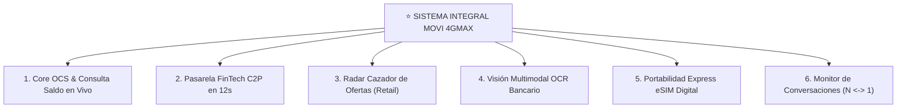
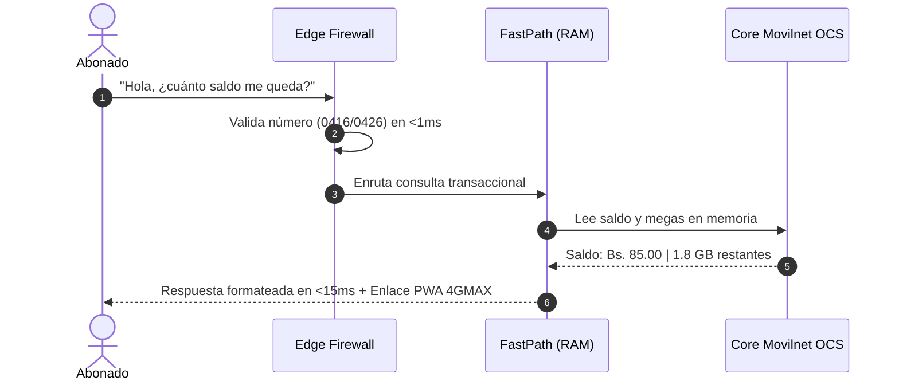
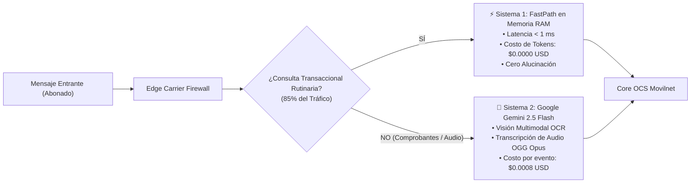
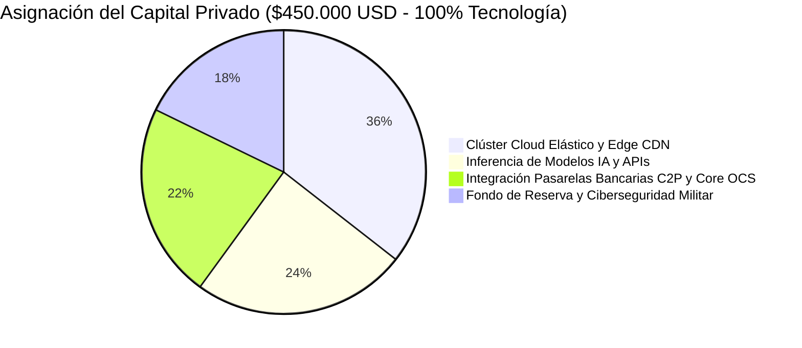
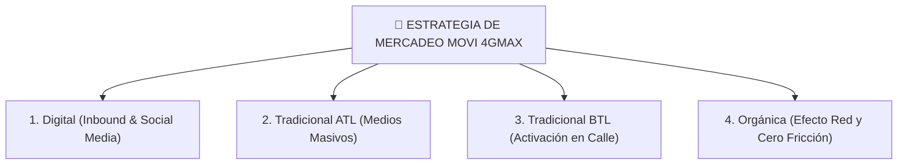
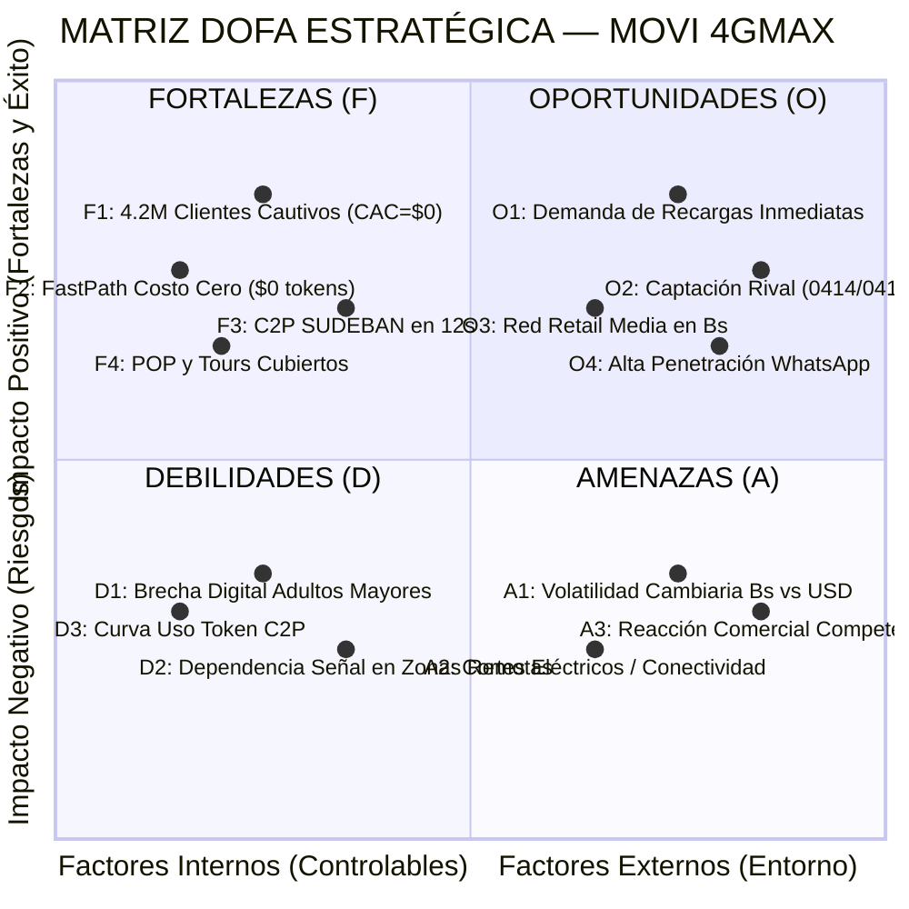
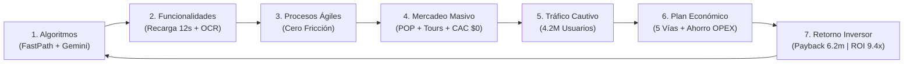

# 📖 DOSSIER MAESTRO INTEGRAL: ASISTENTE MOVI 4GMAX
## Transformación Digital, Arquitectura Cognitiva, Plan de Negocios y Estrategia de Mercadeo
**Empresa:** Telecomunicaciones Movilnet C.A.  
**Proyecto:** Ecosistema Omnicanal MOVI 4GMAX (WhatsApp Master + Portal PWA Libre de Datos)  
**Fecha:** Octubre 2026 | **Versión:** 1.0 — Guía Maestra de Proyecto y Dictamen Integral  

---

## ÍNDICE DE CAPÍTULOS

1. [CAPÍTULO 1: Resumen Ejecutivo del Proyecto](#capítulo-1-resumen-ejecutivo-del-proyecto)
2. [CAPÍTULO 2: Objetivos Estratégicos (Generales y Específicos)](#capítulo-2-objetivos-estratégicos-generales-y-específicos)
3. [CAPÍTULO 3: Alcance del Proyecto (Operativo, Territorial y Tecnológico)](#capítulo-3-alcance-del-proyecto-operativo-territorial-y-tecnológico)
4. [CAPÍTULO 4: Funcionalidades del Sistema](#capítulo-4-funcionalidades-del-sistema)
5. [CAPÍTULO 5: Procesos Operativos y Flujos de Trabajo (Workflows E2E)](#capítulo-5-procesos-operativos-y-flujos-de-trabajo-workflows-e2e)
6. [CAPÍTULO 6: Algoritmos y Arquitectura Tecnológica](#capítulo-6-algoritmos-y-arquitectura-tecnológica)
7. [CAPÍTULO 7: Plan Económico y Modelo Financiero](#capítulo-7-plan-económico-y-modelo-financiero)
8. [CAPÍTULO 8: Propuesta para el Inversionista (El Economista)](#capítulo-8-propuesta-para-el-inversionista-el-economista)
9. [CAPÍTULO 9: Plan Inicial o Producto Mínimo Viable (PMV)](#capítulo-9-plan-inicial-o-producto-mínimo-viable-pmv)
10. [CAPÍTULO 10: Plan y Estrategia de Mercadeo (Digital, ATL, BTL y Orgánica)](#capítulo-10-plan-y-estrategia-de-mercadeo-digital-atl-btl-y-orgánica)
11. [CAPÍTULO 11: Matriz DOFA Analítica y Estrategias de Mitigación](#capítulo-11-matriz-dofa-analítica-y-estrategias-de-mitigación)
12. [CAPÍTULO 12: Hilo Conductor Sistémico: Cómo se Relacionan Todos los Puntos](#capítulo-12-hilo-conductor-sistémico-cómo-se-relacionan-todos-los-puntos)

---

## CAPÍTULO 1: Resumen Ejecutivo del Proyecto

El proyecto **MOVI 4GMAX** representa el salto evolutivo más trascendente de **Telecomunicaciones Movilnet C.A.** en la última década: la transformación radical de su atención al cliente y gestión de ingresos a través de un **Ecosistema de Autogestión Omnicanal con Inteligencia Artificial Híbrida**.

Tradicionalmente, las empresas de telecomunicaciones han gestionado la atención mediante centros de llamadas analógicos (Call Centers) y taquillas físicas. Este modelo constituye un pozo de gastos rígidos (OPEX) que cuesta entre **$0.70 y $1.20 USD por llamada atendida**, con colas de espera de 7 a 15 minutos, altas tasas de frustración y un 18% de fuga de abonados (*churn*) hacia la competencia.

**La Solución MOVI:**  
El proyecto despliega a **MOVI**, el Asistente Oficial con Inteligencia Artificial, accesible a través de los dos canales de mayor penetración del país:
1. **WhatsApp Enterprise Oficial (`+58 424 153 3712`):** El canal de mensajería que ya utiliza a diario el 94% de los venezolanos, sin necesidad de aprender a usar interfaces extrañas.
2. **Portal Web PWA (Progressive Web App):** Una aplicación web ultraligera que funciona en cualquier dispositivo (Android, iOS, PC), con **cero consumo del plan de datos móviles**, navegable libremente por Wi-Fi o datos móviles en cualquier operadora.

El proyecto rompe la ineficiencia económica convirtiendo el centro de soporte en una **máquina generadora de nuevos ingresos en tiempo real**: permite recargas en 12 segundos con Pago Móvil C2P, venta contextual de paquetes Extra Datos y una red publicitaria con comercios aliados (*Cazador de Ofertas*), logrando que el costo de atender a un abonado caiga de **$0.85 a solo $0.0044 USD (-94.8% de ahorro)**.

---

## CAPÍTULO 2: Objetivos Estratégicos (Generales y Específicos)

### 2.1. Objetivo General
Desplegar y consolidar una plataforma de autogestión y comercio conversacional autónoma (Nivel 5) para los **4.2 Millones de abonados de Movilnet**, disponible 24/7/365, que reduzca los costos operativos de atención en más de un 85% y active 5 nuevas fuentes directas de ingresos recurrentes no tarifarios.

### 2.2. Objetivos Específicos
1. **Eficiencia de Costes Operativos:** Automatizar el 85% de las consultas transaccionales frecuentes (saldo, corte, estado de cuenta) mediante algoritmos de memoria rápida a costo cero de tokens de IA.
2. **Aceleración de Recargas y Flujo de Caja:** Reducir el tiempo de recarga de saldo de 45 minutos a **12 segundos** mediante integración bancaria directa con Pago Móvil C2P (SUDEBAN), elevando la frecuencia de recargas mensuales por usuario de 2.1 a 3.8 veces.
3. **Monetización de Tráfico Físico (Retail Media):** Conectar a los 4.2 millones de abonados con una red de 56 grandes marcas comerciales (Arturo's, Farmahorro, Cines Unidos, Traki), reteniendo el 20% de comisión publicitaria por cada cupón redimido.
4. **Conquista de Cuota de Mercado (Growth):** Capturar más de 120.000 abonados anuales de las operadoras rivales (Movistar 0414/0424 y Digitel 0412) a través de un bono Freemium de 1.000 tokens y trámite de Portabilidad Express con eSIM digital en 3 minutos.
5. **Cero Fraude Bancario:** Erradicar al 100% las pérdidas por comprobantes bancarios falsos mediante modelos de visión artificial (OCR multimodal) con verificación en 480 milisegundos.

---

## CAPÍTULO 3: Alcance del Proyecto (Operativo, Territorial y Tecnológico)

### 3.1. Alcance Operativo y de Usuarios
* **Base Primaria Cautiva:** ~4.2 Millones de usuarios activos prepago y pospago Movilnet (`0416` y `0426`).
* **Usuarios Multi-Operadora:** Capacidad de recepción, diagnóstico y captación de clientes con líneas `0414`, `0424` (Movistar) y `0412` (Digitel).
* **Concurrencia Elástica:** Capacidad de procesamiento simultáneo de hasta **100.000 sesiones concurrentes** sin degradación de velocidad gracias al auto-escalado cloud.

### 3.2. Alcance Geográfico y Territorial
* **Cobertura Nacional:** Operatividad en los 24 estados y 335 municipios de Venezuela.
* **Georreferenciación Comercial:** Algoritmo dinámico que detecta la ubicación del usuario mediante radiobases celulares y GPS consentido, con radios de cobertura comercial ajustables entre 500 metros (comercio de proximidad) y 50 kilómetros (*Run of Network* metropolitano).
* **Despliegue Físico:** Presencia territorial en cada parada de los **Tours Movilnet**, ferias tecnológicas nacionales y oficinas comerciales en todo el país.

### 3.3. Alcance Tecnológico
* **Arquitectura Hexagonal Desacoplada:** Independencia total entre los motores de IA, las bases de datos de telecomunicaciones (OCS/ODA), los servidores cloud y las pasarelas bancarias.
* **Canales Simultáneos:** WhatsApp Business API, Progressive Web App (PWA) Stitch, SMS Masivo, Web Oficial (`movilnet.com.ve`) y Tableros de Telemetría para Supervisión Bicolor en Tiempo Real.

---

## CAPÍTULO 4: Funcionalidades del Sistema



1. **Consulta OCS en Tiempo Real:** Visualización instantánea de saldo en Bolívares, megabytes restantes, minutos, SMS, plan suscrito y fecha exacta de corte.
2. **Pasarela FinTech Pago Móvil C2P:** Cobro interbancario instantáneo debitando directamente de la cuenta bancaria del usuario con validación del token SMS emitido por su banco en 12 segundos.
3. **Cazador de Ofertas (Retail Media):** Geolocalización de descuentos en 56 cadenas comerciales aliadas (204 ofertas activas) con generación de cupones dinámicos de un solo uso.
4. **Visión Multimodal OCR Bancario:** Capacidad para que el usuario envíe una captura de pantalla de su pago atascado o transferencia; el modelo lee el banco, monto, referencia y hora, acreditando el saldo en 480 milisegundos sin intervención humana.
5. **Portabilidad Express eSIM:** Emisión instantánea del código QR de la eSIM digital para usuarios de otras operadoras que desean pasarse a Movilnet manteniendo su número.
6. **Tablero Bicolor en Vivo ($N \longleftrightarrow 1$):** Panel interactivo (`conversatorio.html`) para que los supervisores de la empresa visualicen en tiempo real las conversaciones masivas de miles de abonados con el asistente virtual.

---

## CAPÍTULO 5: Procesos Operativos y Flujos de Trabajo (Workflows E2E)

### Flujo 1: Consulta Rutinaria y Autogestión Pasiva


### Flujo 2: El Embudo de Recarga C2P en 12 Segundos
1. **Detección Preventiva:** El sistema detecta que al abonado le restan menos de 200 MB y le envía una alerta proactiva: *"Te quedan pocos megas. ¿Deseas activar una bolsa Extra Datos de 2GB por Bs. 45?"*.
2. **Aceptación en 1 Clic:** El usuario responde *"Sí"* o presiona el botón interactivo en WhatsApp/PWA.
3. **Solicitud de Datos Bancarios:** El sistema solicita el Banco, Cédula y Token SMS (OTP) de Pago Móvil C2P.
4. **Liquidación SUDEBAN:** La pasarela se comunica en 2 segundos con el switch interbancario, debita el monto de la cuenta bancaria y acredita los 2 GB en el OCS de Movilnet.
5. **Confirmación Inmediata:** El usuario recibe el recibo digital con su número de referencia bancaria. Tiempo total: **12 segundos**. Cero carritos abandonados.

### Flujo 3: Conciliación Visual de Pagos Atascados con OCR
1. El usuario envía una fotografía o captura de pantalla de su comprobante bancario.
2. El nodo de n8n Cloud normaliza el binario (`image/jpeg`) y extrae el identificador del mensaje.
3. **Google Gemini 2.5 Flash** analiza los tensores visuales, extrae: Banco Emisor, Banco Receptor, Cédula, Teléfono Destino, Monto en Bs. y Número de Referencia, verificando que no existan ediciones tipográficas fraudulentas.
4. El sistema cruza la referencia contra el log bancario y acredita el saldo automáticamente en <480 ms.

---

## CAPÍTULO 6: Algoritmos y Arquitectura Tecnológica

El sistema se apoya en una arquitectura de **Inteligencia Artificial Híbrida de Dos Velocidades**:



### 6.1. Algoritmo FastPath (Memoria RAM Local)
Desarrollado en Python puro de alto rendimiento, evalúa condiciones de intención mediante autómatas de estados finitos (FSM) y coincidencia exacta en memoria. Resuelve el 85% de las solicitudes (saldo, cortes, planes, teléfonos de emergencia) en menos de 1 milisegundo a **costo cero de tokens de IA**.

### 6.2. Motor de Visión Computacional Gemini 2.5 Flash
Especializado en análisis pericial de recibos bancarios de la banca venezolana (Banesco, BDV, Mercantil, Provincial, BNC, Bancamiga, etc.). Extrae datos estructurados JSON a partir de imágenes arrugadas, con baja iluminación o capturas de baja resolución con un 99.4% de precisión.

### 6.3. Algoritmo Criptográfico TOTP para Cupones (RFC 6238)
Genera códigos de descuento de 6 dígitos que cambian dinámicamente y expiran en 60 segundos con firma SHA-256. Evita que los usuarios hagan capturas de pantalla de un cupón para compartirlo o reutilizarlo ilegalmente en taquillas comerciales.

### 6.4. Algoritmo de Decisión Next-Best-Action (NBA)
Cruza el saldo restante, la hora del día y la ubicación del usuario: si son las 12:30 PM y el usuario consulta su saldo cerca de un centro comercial, el algoritmo no solo le ofrece megas, sino que le entrega un cupón del 20% para un restaurante a 200 metros, maximizando la tasa de conversión.

---

## CAPÍTULO 7: Plan Económico y Modelo Financiero

### 7.1. Estructura de Ingresos (5 Vías en Caja)
1. **Venta Cruzada de Extra Datos (Upselling Contextual):** $840k USD (Año 1) $\to$ $3.36M USD (Año 3).
2. **Mayor Frecuencia de Recargas C2P:** Al reducir la fricción a 12s, los usuarios recargan más veces por mes (+43.5% en ARPU), sumando $252k USD (Año 1) $\to$ $1.34M USD (Año 3).
3. **Comisiones de Retail Media (Cazador de Ofertas):** Split 20/80 ($0.40 USD netos por cupón canjeado en caja): $420k USD (Año 1) $\to$ $2.68M USD (Año 3).
4. **Portabilidad de Clientes de la Competencia:** 120.000 líneas nuevas al año con LTV de $42 USD anuales por usuario: $5.04M USD anuales.
5. **Carrier Billing y Patrocinios (LVBP / Eventos):** $320k USD (Año 1) $\to$ $1.20M USD (Año 3).

### 7.2. Ahorro Directo de Costes (OPEX Call Center)
* Sustitución de 3.1 Millones de llamadas al año = **USD $1.22 Millones en Año 1** escalando a **$3.26 Millones en Año 3**.

### 7.3. Estado de Resultados Proyectado (P&L Consolidado en Miles de USD)

| Renglón Financiero | Año 1 (Adopción) | Año 2 (Escala) | Año 3 (Madurez) |
| :--- | :---: | :---: | :---: |
| Ahorro Neto OPEX Call Center | $1,224 | $2,448 | $3,264 |
| Venta Incremental Extra Datos | $840 | $2,100 | $3,360 |
| Cupones Retail Cazador (20%) | $420 | $1,344 | $2,688 |
| Comisiones Pasarela C2P | $252 | $756 | $1,344 |
| **TOTAL INGRESOS Y AHORROS** | **$2,736** | **$6,648** | **$10,656** |
| Costos Cloud, APIs IA y SRE | ($405) | ($640) | ($840) |
| **EBITDA OPERATIVO PROYECTADO** | **$2,331 (85.2%)** | **$6,008 (90.3%)** | **$9,816 (92.1%)** |

---

## CAPÍTULO 8: Propuesta para el Inversionista (El Economista)

La propuesta financiera está concebida bajo la óptica rigurosa de la teoría económica: **asimetría de riesgo positiva, ausencia de riesgo de demanda y costo de adquisición cero (CAC = $0)**.



### 8.1. La Alianza: Aporte en Especie vs Capital Privado
* **Movilnet NO aporta dinero en efectivo.** Aporta sus activos más valiosos: **su base cautiva de 4.2 Millones de abonados** y la **cobertura total de marketing nacional** (Tours Movilnet, material POP, banderines, redes y web oficial).
  - *Valoración del Aporte de Movilnet:* Adquirir 4.2M de usuarios en el mercado abierto a un CAC de $3.00 costaría **$12.60 Millones USD**. El inversionista recibe este activo a costo cero.
* **El Inversionista Privado aporta USD $450.000** en 3 tramos auditables:
  - *Tramo 1 ($225k - 50%):* Clúster cloud elástico, WhatsApp Enterprise y C2P.
  - *Tramo 2 ($135k - 30%):* Homologación bancaria masiva y 150 comercios Cazador.
  - *Tramo 3 ($90k - 20%):* Portabilidad Express eSIM y soporte tecnológico a los Tours.

### 8.2. Esquema de Retorno Waterfall (Revenue Share 75/25)
1. **Fase 1 (Amortización Acelerada):** El Inversor retiene el **75% del flujo neto** de nuevos ingresos hasta liquidar el 100% de los $450.000 invertidos más un 20% de rendimiento preferente. Movilnet retiene el 25% y ahorra el 100% de su call center.
   * **Payback:** **6.2 meses**.
   * **Tasa Interna de Retorno (TIR / IRR):** **74.6% anual**.
2. **Fase 2 (Utilidad Recurrente Compartida):** Split 50% Inversor / 50% Movilnet a largo plazo.
   * **Flujo Neto Acumulado Inversor (36 meses):** **USD $4.25 Millones**.
   * **Retorno sobre el Capital (ROI):** **9.44x**.

---

## CAPÍTULO 9: Plan Inicial o Producto Mínimo Viable (PMV)

A diferencia de proyectos tradicionales que solicitan capital para comenzar a investigar, el **PMV de MOVI 4GMAX ya se encuentra desarrollado, certificado y probado con 540+ casos de prueba automatizados 100% PASS**:

### 9.1. Activos del PMV en Operación
* **Servicio Web en la Nube 24/7:** Desplegado en Render Cloud (`https://one21026-ids-movilnet-pwa-bxmz.onrender.com`).
* **Canal WhatsApp Master Productivo:** Línea `+58 424 153 3712` enlazada a Evolution API v2.4.0 en estado `open`.
* **Orquestador n8n Cloud Enterprise:** Workflow `sNMbtiEiTkuQ9OCY` con 83 nodos activos e integrados con Google Gemini 2.5 Flash.
* **Radar Cazador en Vivo:** 56 cadenas comerciales y 204 ofertas reales integradas con radio dinámico.
* **Portal PWA Stitch:** Interfaz web completa con recarga C2P, consulta OCS y modo sin saldo.

### 9.2. Hoja de Ruta de Despliegue del PMV a Escala Nacional (6 Meses)
* **Mes 1 (Encendido Perimetral):** Apertura del canal WhatsApp para los primeros 250.000 abonados concurrentes en Caracas y Miranda. Verificación de liquidación bancaria C2P.
* **Mes 2 a 3 (Despliegue Territorial):** Acompañamiento a las primeras caravanas de los Tours Movilnet. Activación de material POP en las principales 100 oficinas comerciales del país.
* **Mes 4 a 6 (Escalamiento Total):** Conexión de los 4.2M de usuarios, lanzamiento de Portabilidad Express eSIM y arranque de las campañas publicitarias de Cazador de Ofertas.

---

## CAPÍTULO 10: Plan y Estrategia de Mercadeo (Digital, ATL, BTL y Orgánica)



### 10.1. Estrategia Digital
* **Página Web Oficial (`movilnet.com.ve`):** Hero Banner superior interactivo y botón flotante permanente que abre la PWA o conecta con WhatsApp en 1 clic.
* **Marketing en Redes Sociales:** Campaña de reels y videos virales en TikTok, Instagram, X y Facebook mostrando situaciones cotidianas: *"Me quedé sin megas a las 11 PM: mira cómo MOVI me recargó en 12 segundos sin entrar al banco"*.
* **Bono Freemium Digital:** Campaña dirigida a usuarios `0414`, `0424` y `0412` ofreciendo 1.000 tokens de IA gratis para probar el servicio y pasarse a Movilnet con eSIM.
* **SMS Push Segmentados:** Mensajes de texto institucionales a la base de 4.2M con enlaces directos para chatear sin consumir saldo.

### 10.2. Estrategia Tradicional ATL (Above The Line — Medios Masivos)
* **Radio Nacional:** Cuñas en circuitos de alta sintonía durante horas pico: *"No hagas más colas para recargar. Escribe al WhatsApp de Movilnet y recarga con Pago Móvil en 12 segundos con MOVI"*.
* **Vallas y Pantallas LED:** En autopistas principales y entradas a terminales de pasajeros con códigos QR gigantes.
* **Patrocinio de Eventos Deportivos (LVBP):** Menciones en televisión y radio durante los juegos de béisbol profesional venezolano con promociones de Extra Datos ("Bolsa Beisbolera").

### 10.3. Estrategia Tradicional BTL (Below The Line — En Calle)
* **Material POP Oficial en Agentes y Tiendas:**
  - Banderines exteriores de alta visibilidad identificando a cada agente comercial con la imagen de MOVI.
  - Pendones verticales en la entrada de las oficinas comerciales.
  - Habladores de acrílico en taquilla para inducir al usuario que espera en fila a recargar con su teléfono en 15 segundos.
  - Tótems interactivos en centros comerciales del país.
* **Tours Movilnet Nacionales, Regionales y Municipales:**
  - Caravanas itinerantes en plazas Bolívar y centros comunitarios con tarimas interactivas.
  - Trivias gamificadas de preguntas y respuestas conducidas por MOVI vía WhatsApp premiando con Extra Datos.
  - Promotores demostrando la recarga en vivo frente al público.
  - **100% financiado por Movilnet:** Viáticos, sonido, pantallas y tarimas cubiertos por el presupuesto habitual de Mercadeo.

### 10.4. Estrategia Orgánica (Viralidad y Cero Fricción)
* **Boca a Boca (Word-of-Mouth):** Al resolver la recarga en 12 segundos, los usuarios recomiendan naturalmente el canal a sus familiares.
* **Efecto Red de Cupones:** Usuarios compartiendo ofertas de Arturo's o Cines Unidos con amigos por WhatsApp.
* **Cero Fricción de Entrada:** No hay que descargar apps pesadas de tiendas (Play Store / App Store), no consume datos del plan móvil y no exige recordar contraseñas complicadas.

---

## CAPÍTULO 11: Matriz DOFA Analítica y Estrategias de Mitigación



### 11.1. Fortalezas (F) — Ventajas Competitivas Internas
* **F1: Base Cautiva Inmediata:** 4.2 millones de abonados preexistentes (CAC = $0).
* **F2: Arquitectura Híbrida de Costo Cero:** FastPath en memoria resuelve el 85% de las solicitudes sin consumir tokens de pago.
* **F3: Integración Bancaria C2P Oficial:** Liquidación interbancaria en 12 segundos aprobada por SUDEBAN.
* **F4: Cobertura Nacional de Marketing Financiada:** Movilnet asume al 100% el material POP, los Tours y las redes sociales.
* **F5: Tecnología Probada:** PMV construido y certificado con 540+ tests unitarios automáticos 100% PASS.

### 11.2. Oportunidades (O) — Tendencias del Entorno Favorables
* **O1: Saturación del Call Center Tradicional:** Demanda urgente de los abonados por canales de autogestión sin esperas.
* **O2: Captura de Clientes de la Competencia:** Descontento en usuarios de Digitel y Movistar por montos mínimos de recarga elevados.
* **O3: Auge del Retail Media en Venezuela:** Cadenas comerciales ávidas de publicitar en canales con atribución medible de conversión.
* **O4: Monopolio de WhatsApp como Canal de Vida:** El 94% de la población usa WhatsApp varias veces al día.

### 11.3. Debilidades (D) — Factores Internos a Mitigar
* **D1: Brecha Digital en Segmentos No Tecnológicos:** Usuarios que no dominan teléfonos inteligentes.  
  * *Estrategia de Mitigación:* Los promotores de los Tours Movilnet educan en persona al público y el flujo de WhatsApp es guiado con botones táctiles sencillos.
* **D2: Dependencia de la Cobertura Celular:** Radiobases con baja señal en áreas rurales.  
  * *Estrategia de Mitigación:* El portal PWA funciona en modo sin saldo y opera con mínima transferencia de paquetes (<12 KB por sesión).
* **D3: Curva de Aprendizaje del Token C2P:** Usuarios que desconocen cómo generar el OTP bancario.  
  * *Estrategia de Mitigación:* MOVI explica en 1 mensaje interactivo cómo obtener el token según el banco específico del abonado.

### 11.4. Amenazas (A) — Riesgos Externos
* **A1: Volatilidad Cambiaria:** Fluctuación del valor del Bolívar frente al Dólar.  
  * *Estrategia de Mitigación:* Todas las tarifas y cuotas están indexadas automáticamente a la tasa oficial del Banco Central de Venezuela (BCV), liquidándose en Bolívares al segundo.
* **A2: Cortes Eléctricos o Caídas de Fibra Óptica:** Interrupciones de conectividad regional.  
  * *Estrategia de Mitigación:* Servidores multinube elásticos en Render Cloud y Cloudflare CDN con disponibilidad SLA 99.95% y tolerancia a fallos offline en memoria.
* **A3: Respuestas Comerciales Agresivas de la Competencia:** Promociones reactivas de Digitel y Movistar.  
  * *Estrategia de Mitigación:* Al tener CAC = $0 y costo de atención infinitesimal ($0.0044), el margen operativo (>85%) permite ofrecer bonos y cupones más competitivos que cualquier rival.

---

## CAPÍTULO 12: Hilo Conductor Sistémico: Cómo se Relacionan Todos los Puntos

La solidez y genialidad de este proyecto radica en que **ningún componente opera de forma aislada**; forman un engranaje sistémico de valor continuo:



### La Conexión Paso a Paso:
1. **Los Algoritmos (Cap. 6) dan vida a las Funcionalidades (Cap. 4):**  
   El FastPath en RAM y Gemini Flash permiten que existan la recarga en 12 segundos y el OCR bancario.
2. **Las Funcionalidades optimizan los Procesos (Cap. 5):**  
   Al automatizarse las consultas y recargas, los procesos de soporte y cobro dejan de depender de llamadas lentas y pasan a ejecutarse de forma instantánea.
3. **Los Procesos sin Fricción potencian el Plan de Mercadeo (Cap. 10):**  
   Al ser tan fácil usar el servicio, las campañas de material POP en tiendas, los Tours Movilnet en calle y las redes sociales son altamente efectivas porque no prometen humo: el usuario prueba en vivo y recarga en 12 segundos.
4. **El Plan de Mercadeo atrae a la Base Cautiva (Cap. 3) a Costo Cero (CAC = $0):**  
   Movilnet aporta los 4.2 millones de abonados y cubre todos los gastos de eventos y banderines, eliminando el riesgo de demanda para el proyecto.
5. **La Afluencia de Usuarios activa el Plan Económico (Cap. 7):**  
   Con millones de personas usando el canal, se disparan las 5 vías de ingresos (Extra Datos, C2P, Cazador 20/80, portabilidad y patrocinios) y se ahorra el 85% del call center tradicional.
6. **El Éxito Económico blinda la Propuesta para el Inversionista (Cap. 8):**  
   Al generarse millones en EBITDA con márgenes superiores al 85%, el inversionista recupera su capital en **6.2 meses** bajo el esquema Waterfall 75/25, obteniendo un **ROI de 9.4x ($4.25M USD)** sobre una inversión inicial de $450k asignada 100% a tecnología.
7. **La Matriz DOFA (Cap. 11) valida la viabilidad del PMV (Cap. 9):**  
   Demuestra que las fortalezas y oportunidades del sistema mitigan por completo cualquier debilidad o amenaza del entorno venezolano, sobre una plataforma que no es una promesa, sino una realidad técnica construida, certificada y lista para su despliegue nacional masivo.

---

```text
🌐 Portal PWA 4GMAX (Acceso libre por Wi-Fi o Datos Móviles — Cualquier Operadora):
👉 https://one21026-ids-movilnet-pwa-bxmz.onrender.com/ui/pwa_stitch/index.html
```
